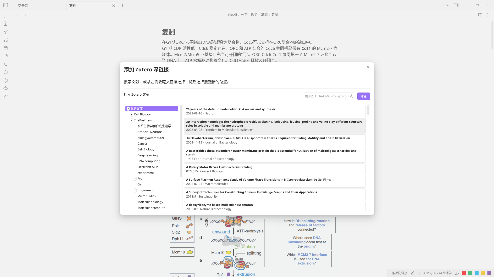

# Zotero Deep Linker for Obsidian（中文）

[English](README.md) | 中文版

一个 Obsidian 桌面端插件，搜索本地 Zotero 库并插入文献条目、PDF 附件或某条具体 PDF 注释的 Markdown 深链接。



## 使用方法

1. 保持 Zotero 运行，并启用 **设置 → 高级 → API → 启用本地 API**（默认端口 **23119**，即 `http://127.0.0.1:23119`）。
2. 在 Obsidian Markdown 笔记中，从命令面板运行 **Zotero Deep Linker: 添加 Zotero 深链接**，或点击侧边栏链式图标。
3. 按标题、作者、DOI 或关键词搜索，或在左侧收藏夹树中直接浏览。两种方式在同一窗口均可使用。不属于任何条目的独立 PDF 与独立笔记也会出现在列表中，并带有各自的图标，不会被误认成文献条目。
4. 选择 **文献条目**、**PDF / 注释** 或 **笔记**。选项下方的小字会显示该条目下 PDF、注释、笔记的数量；独立 PDF 则直接进入自身的 PDF / 注释选择。

链接显示文字默认为条目名称；注释为「名称（第 X 页）」，笔记为「名称 - 笔记 N」（独立笔记没有父条目，直接用其正文开头）。
若在运行命令（或点击侧边栏图标）**之前**在编辑器中选中了文本，则用该选中文本作为链接文字。

插入的链接形式如下：

```markdown
[条目名称](zotero://select/library/items/ITEM_KEY)
[条目名称](zotero://open-pdf/library/items/PDF_KEY)
[条目名称（第 X 页）](zotero://open-pdf/library/items/PDF_KEY?page=PAGE&annotation=ANNOTATION_KEY)
[条目名称 - 笔记 1](zotero://select/library/items/NOTE_KEY)
```

插件**不会修改** Zotero 条目、PDF 或注释，仅读取本地 API 并将链接插入当前 Obsidian 编辑器。

## 前置要求

- **Obsidian ≥ 1.8.0**（仅桌面端）
- **Zotero 桌面端运行中**且**已启用本地 API**  
  (`设置 → 高级 → API → 启用本地 API`，默认 `http://127.0.0.1:23119`)
- **无需任何其他 Obsidian 插件**
- **无需任何 Zotero 插件/扩展**

## 设置

默认 Zotero Local API 地址为 `http://127.0.0.1:23119`。仅当你的 Zotero 使用不同地址时，在 **设置 → 社区插件 → Zotero Deep Linker** 中修改。

同一设置页还提供 **文件夹列最小宽度**，默认 150 px，可根据收藏夹名称长度调整。

## 语言

界面语言跟随 Obsidian 语言设置：
- 英文（默认）
- 中文（当 Obsidian 语言设为中文时）

## 开发

```bash
npm install
npm run build
```

## 许可证

MIT